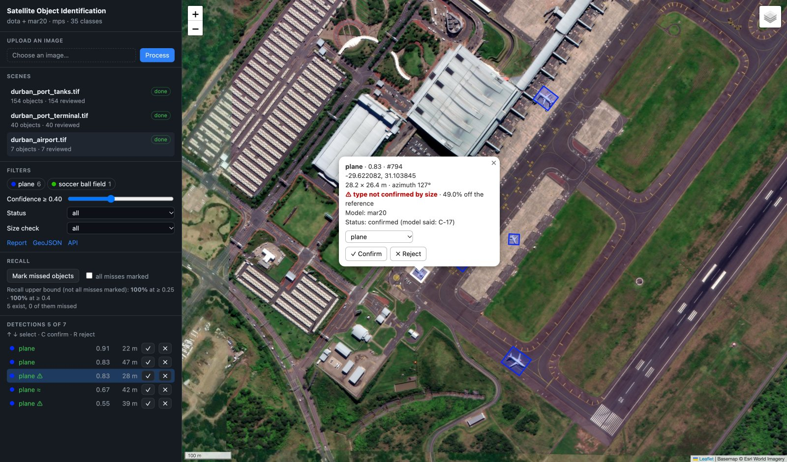
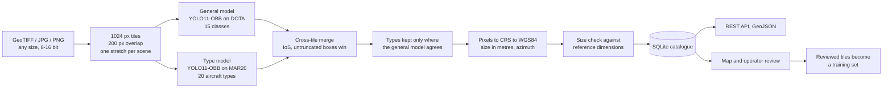
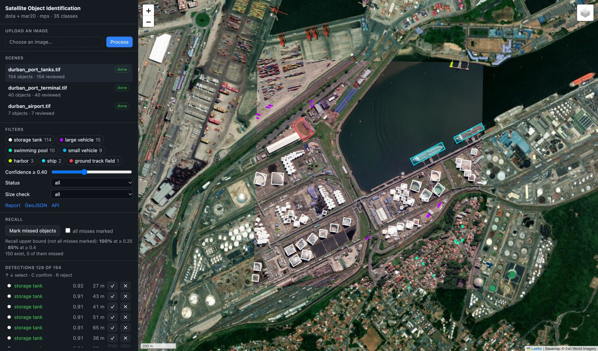
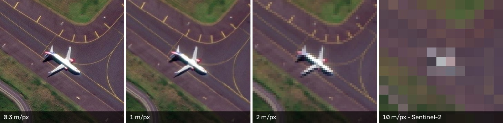

# Satellite Object Identification

**Detect, classify and georeference objects in satellite imagery, then check the classifier with physics.**


A working prototype built in four days by a team of two for the **NU STeP × Defense Tech Challenge**
(Astana, September 2026), Task 3: automated detection, recognition and classification of objects in
satellite imagery, set by the Military Space Programmes Centre of the Ministry of Defence of Kazakhstan.
The project was selected as a finalist for Demo Day.



<sub>The operator map on a real WorldView scene of King Shaka airport, Durban. The type model called this
aircraft a C-17 with 0.83 confidence. The size check measured it at 28.2 × 26.4 m against a reference
of 53.0 × 51.8 m and flagged the type as not confirmed (⚠). The operator kept the object and relabelled it
`plane`. Imagery © Maxar Technologies, Maxar Open Data Program (CC BY-NC 4.0); basemap © Esri.</sub>

## Highlights

- **0.899 mAP50 on the official MAR20 test set** (20 military aircraft types, 2511 images) after
  25 minutes of transfer learning from DOTA weights; 15.7 ms per image on a T4.
- **A physical check on the classifier.** Every detection is georeferenced, so its size is known in
  metres. Comparing it with the reference dimensions of the predicted type catches confident mistakes
  the network cannot see: a "C-17" at 0.83 confidence measured 28 m long, while a real C-17 is 53 m.
- **A weakness found, fixed and attributed.** Robustness tests showed sensor noise collapsing mAP50
  from 0.900 to 0.063. Noise augmentation brought it back to 0.890, and a controlled run on three
  models showed that the augmentation, not the model size, was responsible. A check on a real scene
  then kept the noise-free model as the default: it shows the operator 4 aircraft where the
  noise-trained one shows 3.
- **Honest evaluation on real imagery.** Every one of the 201 detections on three Maxar scenes was
  reviewed: 94.0% are real objects and 92.0% have the right class. On a civilian airport only 1 of 7
  aircraft got a correct type, because MAR20 has no civilian classes, and we report that number too.
- **Measured resolution limits.** Storage tanks survive degradation to 2 m/px (113 of 114), aircraft
  types hold to about 1 m/px, and nothing is left at Sentinel-2's 10 m/px. The 10 m case was confirmed
  on a real Sentinel-2 scene over Atyrau, Kazakhstan.
- **A complete system, not a notebook.** Tiling of arbitrarily large GeoTIFFs, cross-tile merging, WGS84
  output, an SQLite catalogue, a REST API, a Leaflet map with keyboard review, HTML reports, recall
  measurement, reconciliation with an equipment registry, and export of reviewed detections back into a
  training set. 60 automated tests.
- **About 3600 km²/h on a laptop** (Apple M1, synthetic scene at 0.5 m/px, general model only).

## How it works



- **Oriented boxes.** Aircraft on an apron and ships at a berth sit at arbitrary angles and close
  together. Axis-aligned boxes around them are half background and get merged by NMS; oriented boxes
  separate them and also give each object's heading.
- **Two models, one job each.** The general model (DOTA, 15 classes) finds ships, storage tanks,
  vehicles, harbours and aircraft. The type model (MAR20) names the aircraft type, but its detections
  survive only where the general model found the same object. Without that rule it "recognised"
  Tu-95 bombers in port cranes with 0.71 confidence.
- **Seams handled explicitly.** An object on a tile border is cut off in one tile, so plain IoU misses
  the duplicate. Duplicates are matched by intersection over the smaller box, and the box not touching a
  tile edge wins.
- **One contrast stretch per scene.** 11/16-bit imagery is stretched with one pair of percentiles for the
  whole scene, so contrast does not jump between tiles; empty tiles are detected from raw values, so dark
  water is not mistaken for nodata.

## Results

### Aircraft type recognition: MAR20 test set (2511 images, 14,471 objects)

| Model | Noise augmentation | mAP50 | mAP50-95 | Inference (T4) |
|---|---|---|---|---|
| **yolo11s** (default) | no | 0.899 | 0.786 | **15.7 ms** |
| yolo11s | yes | 0.898 | 0.784 | 18.3 ms |
| yolo11m | no | 0.904 | 0.795 | 43.7 ms |
| yolo11m | yes | **0.915** | **0.804** | 40.4 ms |

Large distinctive aircraft reach 0.97–0.99 (B-1B 0.990, TU-160 0.988, TU-95 0.978); small look-alike
fighters are the hard part (F-22 0.589, F-15 0.745). The per-class breakdown is in
[NOTES.md](NOTES.md#sep-16-fine-tuning-on-mar20), training curves in [docs/training](docs/training).

### Real imagery: operator review of every detection

Three 4096×4096 WorldView scenes of Durban at 0.3 m/px: a container terminal, an oil terminal and an
airport. One operator reviewed all 201 detections at the catalogue threshold of 0.25.

| What is checked | All scenes | Airport only |
|---|---|---|
| the detected object is real | 189/201 = **0.940** | 5/7 = 0.714 |
| the class or type is correct | 185/201 = **0.920** | 1/7 = **0.143** |

The airport gap is the point of reporting two numbers: King Shaka is a civilian airport, MAR20 knows only
military types, so every airliner got a military label. One averaged number would have hidden this.
This is precision only; recall is measured with a separate tool (see [Recall](#recall)).



<sub>The oil terminal scene at the default threshold of 0.4: storage tanks, tankers at the berth, trucks
and swimming pools. Imagery © Maxar Technologies, Maxar Open Data Program (CC BY-NC 4.0); basemap © Esri.</sub>

### Robustness to image quality

400 MAR20 test images, each degradation applied to the same subset:

| Degradation | yolo11s | yolo11s + noise aug. | yolo11m + noise aug. |
|---|---|---|---|
| original | 0.900 | 0.900 | 0.923 |
| Gaussian noise σ=15 | 0.371 (−58.8%) | **0.900 (−0.1%)** | 0.918 (−0.5%) |
| Gaussian noise σ=30 | 0.063 (−93.0%) | **0.890 (−1.2%)** | 0.906 (−1.9%) |

Blur, JPEG compression, lower resolution (down to ÷4), low light and haze cost the baseline at most
4.8% mAP50 (relative).
Noise was the one real weakness; the same architecture trained with noise no longer collapses. Details:
[docs/training/robustness.md](docs/training/robustness.md).

### Resolution limit



The demo scenes were degraded step by step and run through the same pipeline (one run per resolution):

| Resolution | Storage tanks found (of 114) | Aircraft found | Aircraft with a type |
|---|---|---|---|
| 0.3 m | 114 | 6 | 4 |
| 1 m | 104 | 5 | 3 |
| 2 m | 113 | 5 | 1 |
| 5 m | 66 | 4 | 1 (wrong) |
| 10 m (Sentinel-2) | 5 | 0 | 0 |

A real Sentinel-2 scene over Atyrau, Kazakhstan, agrees: three detections in a 20 km window of an oil
city with a river port, one of them false, and no storage tanks or ships. The system warns about coarse
imagery by itself. Extrapolating from the degraded scenes: 1–2 m imagery is enough for infrastructure,
and aircraft types need about 1 m.

## The size check

Measured dimensions are compared with the reference length and wingspan of the predicted type
(`detector/physical.py`). There are three verdicts rather than one threshold, because a binary answer
right at the boundary misleads:

| Deviation from reference | Verdict | Demo airport |
|---|---|---|
| up to 15% | size matches | E-8: 6.8% |
| 15–25% | borderline (≈) | C-17: 24.7% |
| over 25% | type not confirmed (⚠) | C-17: 49.0%, C-5: 48.6% |

Variable-sweep aircraft (Tu-160, B-1B, Tu-22M, Su-24) are accepted in both wing positions. The check is a
filter, not proof: the E-8 is built on the Boeing 707 airframe and is indistinguishable by size from a
civilian wide-body, so it passes. Nothing is deleted; the verdict is stored with the detection, shown on
the map and in the report, and the decision stays with the operator.

## Quick start

```bash
python3 -m venv .venv
.venv/bin/pip install -r requirements.txt
.venv/bin/python -m pytest tests -q

# single image: JSON with detections and a picture with boxes
.venv/bin/python scripts/infer.py samples/boats.jpg

# a real scene: download a 4096 px window of Maxar Open Data, then detect
.venv/bin/python scripts/fetch_demo_scene.py durban_airport
.venv/bin/python scripts/detect_scene.py data/demo/durban_airport.tif

# server: map at http://127.0.0.1:8000, API docs at http://127.0.0.1:8000/docs
.venv/bin/uvicorn api.app:app --host 127.0.0.1 --port 8000
```

`yolo11s-obb.pt` (the DOTA model) is downloaded to `weights/` on first run. Other demo presets:
`durban_port_terminal`, `durban_port_tanks`, `atyrau_s2` (Sentinel-2). The server is configured with
`WEIGHTS`, `DEVICE` (`cpu` / `mps` / `0`), `CONF` and `DATA_DIR`.

### Running both models

```bash
MODELS="dota=weights/yolo11s-obb.pt,mar20=weights/mar20_s_800.pt:refine" .venv/bin/uvicorn api.app:app
```

Order sets priority when two models find the same object. The `:refine` suffix makes a model refine
types only where the general model found an object. There are three type models, and switching between
them is one environment variable:

| Weights | When | Cost |
|---|---|---|
| `mar20_s_800.pt` (default) | clean imagery, the normal case | drops to 0.063 under heavy noise |
| `mar20_s_800_noise.pt` | noisy imagery | more cautious on clean images: 3 aircraft above 0.4 where the default shows 4 |
| `mar20_m_800_noise.pt` | archive processing, time not critical | +40% scene time for +0.023 mAP50 |

Fine-tuned weights are not committed (`weights/` is in `.gitignore`). They are reproduced with
[`notebooks/kaggle_train.ipynb`](notebooks/kaggle_train.ipynb)
([open in Kaggle](https://www.kaggle.com/kernels/welcome?src=https://github.com/miss-mississippi/muxxed_defence_tech/blob/main/notebooks/kaggle_train.ipynb)):
`NOISE=0.5` turns on noise augmentation, `MODEL=yolo11m-obb.pt` selects the `m` architecture.

## Recall

Precision comes from review, but a missed object never appears in the list, so recall needs its own
tool. On the map the operator switches to "Mark missed objects", clicks the objects the model missed and
then confirms that the whole scene was inspected. Recall is computed per class at thresholds 0.25 and
0.4; until the scene is marked complete it is shown as an upper bound. The review data already shows
that the 0.4 map threshold is expensive: detections at 0.25–0.4 are 80% precise, and the threshold hides
36 real objects to avoid showing 9 false ones.

## Registry reconciliation

A prototype that compares detected aircraft with what an equipment registry lists for each airfield
(`detector/inventory.py`). The registry is a list of airfields, each a WGS84 polygon with aircraft
counts by type. It is passed in the request and never stored. The repository only holds a mock example,
[`samples/registry_demo.json`](samples/registry_demo.json), with invented aircraft at the civilian Durban
airport.

```bash
.venv/bin/python scripts/check_inventory.py data/demo/durban_airport.tif --registry samples/registry_demo.json
curl -X POST "http://127.0.0.1:8000/api/scenes/$SCENE_ID/inventory" -H "Content-Type: application/json" --data @samples/registry_demo.json
```

A type is counted only if the measured size does not contradict it. Without that rule the demo produces
two wrong answers at once: "C-17: matches" (one of the two cannot physically be a C-17) and a false alarm
about an unlisted C-5. An airfield outside the image is reported as "cannot reconcile" rather than "all
aircraft missing", types the model does not know are reported separately, and the report warns when
the resolution is too coarse for types.

## REST API

| Method | Path | Purpose |
|---|---|---|
| POST | `/api/scenes` | upload an image; processed in the background (202) |
| GET | `/api/scenes`, `/api/scenes/{id}` | status, progress, metadata, counts by class |
| DELETE | `/api/scenes/{id}` | delete a scene with its detections, marks, image and preview |
| GET | `/api/scenes/{id}/preview.png` | scene preview in EPSG:3857 for the map |
| GET | `/api/scenes/{id}/report` | HTML report, printable to PDF |
| GET | `/api/detections` | GeoJSON catalogue, filters: `scene_id`, `class_name`, `model`, `min_conf`, `status`, `size_check`, `bbox` |
| GET, PATCH | `/api/detections/{id}` | one detection; operator review `{status, class_name?, comment?}` |
| GET | `/api/stats` | totals by class and review status |
| POST | `/api/detect` | image in, GeoJSON out, nothing stored (for external systems) |
| POST | `/api/scenes/{id}/inventory` | reconcile the scene's aircraft with a registry sent in the body |
| POST, GET | `/api/scenes/{id}/missed` | mark an object the model missed / list marks |
| DELETE | `/api/missed/{id}` | remove a mark |
| PUT | `/api/scenes/{id}/completeness` | confirm that all misses are marked |
| GET | `/api/scenes/{id}/recall` | recall per scene and class at thresholds 0.25 and 0.4 |
| GET | `/api/health`, `/api/model` | health and model classes |

## Using it from Python

```python
from detector import Detector, detect_scene

det = Detector()                                     # weights/yolo11s-obb.pt, imgsz=1024
dets = det.predict(tile, offset=(x0, y0), rgb=True)  # HxWx3 uint8 tile -> detections in scene pixels
result = detect_scene(det, "scene.tif")              # whole scene -> SceneResult
geojson = result.to_geojson()                        # FeatureCollection in WGS84
```

The detection format and the coordinate convention are documented in `detector/schema.py`.

## Training and evaluation

```bash
# MAR20 (military aircraft, 20 types) -> YOLO-OBB format
.venv/bin/python scripts/prepare_mar20.py --src /path/to/MAR20 --out data/mar20_yolo

# fine-tune from the DOTA weights; best weights -> weights/<name>.pt, metrics -> outputs/eval/
.venv/bin/python scripts/train.py --data data/mar20_yolo/mar20.yaml --name mar20_s_800 --imgsz 800 --batch 16

# evaluate: mAP50, mAP50-95, per-class P/R, speed
.venv/bin/python scripts/eval.py --data data/mar20_yolo/mar20.yaml --weights weights/mar20_s_800.pt --split test

# robustness to noise, blur, compression, resolution, light and haze
.venv/bin/python scripts/robustness.py --data data/mar20_yolo/mar20.yaml --weights weights/mar20_s_800.pt --split test

# throughput on a large scene: tiles/s, Mpx/s, km²/h
.venv/bin/python scripts/benchmark.py --size 8192 --gsd 0.5

# reviewed detections from the catalogue -> YOLO-OBB dataset for further fine-tuning
.venv/bin/python scripts/export_reviewed.py --out data/reviewed_yolo
```

Training ran on Kaggle (2× T4); the robustness measurement on trained weights has its own notebook,
[`notebooks/kaggle_robustness.ipynb`](notebooks/kaggle_robustness.ipynb).

## Repository layout

```
detector/     ML core: models, tiling, merging, georeferencing, size check, registry reconciliation
api/          FastAPI service, SQLite catalogue, operator review, recall, reports
web/          Leaflet map (Leaflet is vendored in web/vendor, so it works without a CDN)
scripts/      inference, scene detection, data preparation, training, evaluation, benchmarks
notebooks/    Kaggle notebooks for training and robustness measurement
tests/        pytest: tiling, merging, georeferencing, converter, API, size check, reconciliation, recall
docs/         technical report, training plots, figures
NOTES.md      dated engineering log: decisions, measurements, mistakes and corrections
```

## Limitations

- **No civilian aircraft classes.** MAR20 is military only, so on a civilian airport every airliner gets
  a military type. The size check flags three of four such cases on the demo; the fourth is a genuine
  size match.
- **No sub-metre open imagery of Kazakhstan exists**, so the demo uses Durban. The pipeline takes any
  georeferenced GeoTIFF without code changes.
- **The demo review is one operator's visual check**, not an expert assessment, and recall on the demo
  scenes has not been measured yet; the tool for it is in place.
- **The size check covers 20 aircraft types**, i.e. 4 of the 201 demo detections. Ships, tanks and
  vehicles have no reference table yet.
- **Small vehicles** come out at 0.25–0.35 confidence and are hidden at the default map threshold of 0.4.
- **The demo data is non-commercial** (MAR20 and Maxar Open Data are CC BY-NC). A real deployment needs
  licensed imagery and a commercially usable training set.

The full discussion is in the [technical report](docs/report.md#8-limitations).

## Documentation

- [docs/report.md](docs/report.md): technical report covering methods, input requirements,
  evaluation methodology, results, limitations and recommendations.
- [NOTES.md](NOTES.md): the dated engineering log, including failed attempts and corrections after
  external review.
- [docs/training](docs/training): training curves, PR curve, confusion matrix, robustness tables.

## Data and licences

Pretrained weights and transfer learning are used deliberately.

- **Ultralytics YOLO**: AGPL-3.0, <https://github.com/ultralytics/ultralytics>. Because the project uses
  an AGPL-3.0 library, its code is also distributed under AGPL-3.0.
- **yolo11s-obb.pt**: Ultralytics pretrained weights trained on DOTA-v1.0 (15 classes), AGPL-3.0,
  <https://github.com/ultralytics/assets/releases>.
- **DOTA**: the dataset behind the base weights, <https://captain-whu.github.io/DOTA/>; academic use only
  per its authors.
- **MAR20**: the fine-tuning dataset (military aircraft), CC BY-NC 4.0, <https://gcheng-nwpu.github.io/>.
- **Durban demo imagery**: Maxar Open Data Program, CC BY-NC 4.0, © Maxar Technologies,
  <https://registry.opendata.aws/maxar-open-data/>. Not stored in the repository; downloaded with
  `scripts/fetch_demo_scene.py`. The screenshots in `docs/images` are derived from it.
- **Atyrau imagery**: Copernicus Sentinel-2 L2A, 2026-09-14, 10 m/px, via AWS Open Data
  (`sentinel-cogs`), preset `scripts/fetch_demo_scene.py atyrau_s2`. Copernicus data is free **including
  commercial use**, unlike MAR20 and Maxar above.
- **Leaflet 1.9.4**: BSD-2-Clause, <https://leafletjs.com>.
- Basemaps: Esri World Imagery and OpenStreetMap, online only, with attribution.
- **samples/boats.jpg**: an example image from the Ultralytics documentation.

## Authors

Beknur Orazbay and Ramazan Ongarov.
